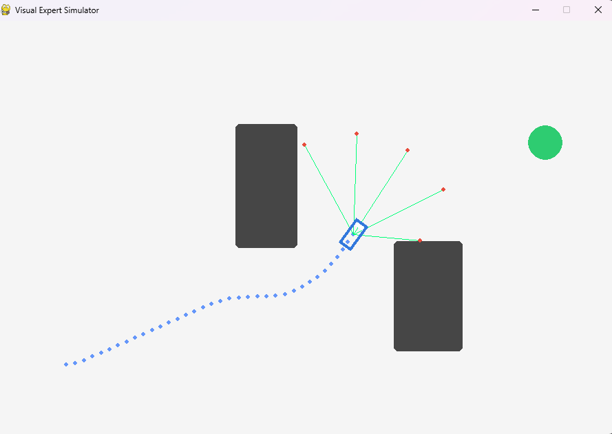
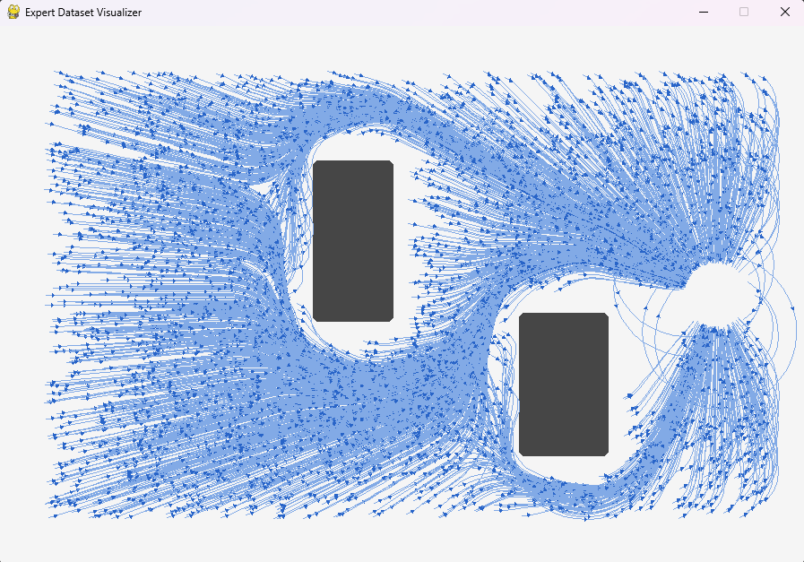
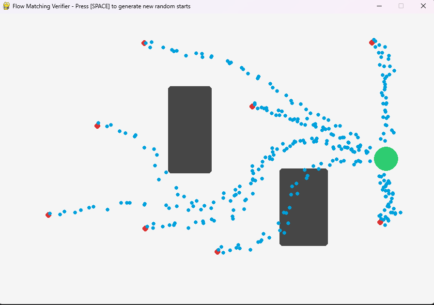

# Path Planner using Conditional Flow Matching (CFM)

An autonomous navigation path planner built from scratch in PyTorch, utilizing **Conditional Flow Matching (CFM)** to morph straight-line priors into collision-free, expert trajectories via ODE integration.

For simplicity the goal and objects stay the same. The starting point is varied. 

Here the 2D car including the simulated lidar sensor can be seen. The car can accelerate and steer. An implemented "expert system" controls the car which is done by pulling the car to the goal and pushing it away from objects. 

  

This is an overview of the successful paths generated by the expert system.

  

A MLP is then trained on the generated data. This screenshot shows paths created by using flow matching. 

  

